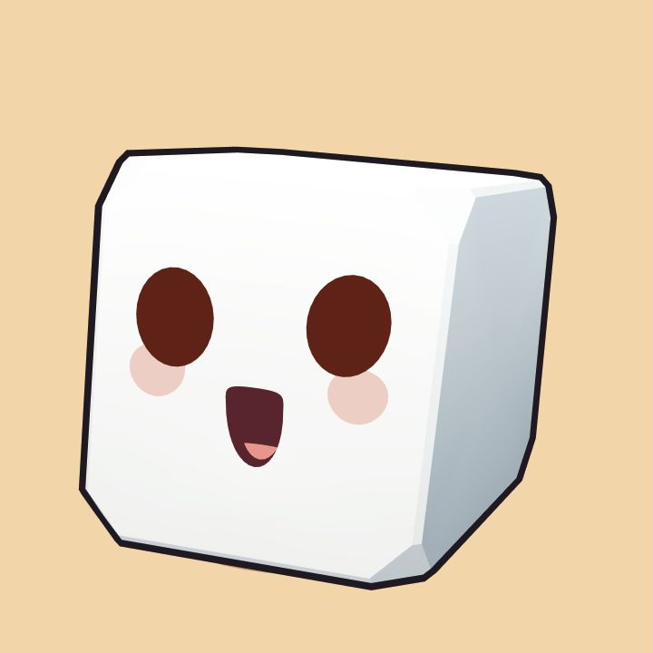
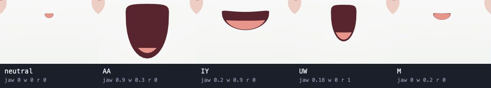

# wahwah

Type “Hello there! How are you today?” and a puppet speaks it in an invented
language, keeping the rhythm of the greeting and the rise at the end of the
question. Switch the voice to a muted trombone to hear the same line as a
cartoon *wah-wah*. You can also drive the mouth with your microphone.





## Run the playground

With Node.js 24 or 26 and npm installed, run these commands from the repository directory.

```sh
npm ci
npm run dev
```

Open the local URL Vite prints. In **Text to babble**, press **Play line** to
hear the sample, then type a line of your own. Open **Voice → Sound engine**
to compare klattsch, Wah-wah trombone, and Babble Engine.

Use **Input mode** to try the same puppet with another source.

- **Phoneme script** lets you write the sounds yourself. Try `M AA . IY . UW`
  and compare the small, open, wide, and rounded mouth shapes.
- **Live microphone** follows your voice as you speak. Choose **Microphone** or
  **Demo voice** under **Input**, then press **Start**. Allow microphone
  access if you chose the mic.

## Explore further

- [Playground guide](docs/playground.md) — shape a voice, calibrate your microphone, compare playback delays, or load a VRM or Live2D character.
- [Architecture](docs/architecture.md) — follow a syllable from the audio timeline to the three controls that move the mouth.
- [Project goals and decisions](docs/goals.md) — visual influences and plans for a reusable puppet SDK.
- [Development notes](docs/development-notes.md) — run the checks and measure voice-to-mouth timing.
