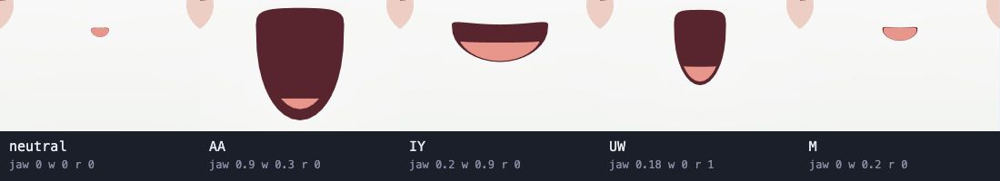

# How a voice moves the puppet

Every input drives the same three mouth controls. A generated line has a known sequence of sounds, so the playground can prepare the mouth movement before playback. Live input estimates the controls as audio arrives.

## Generated speech

1. In text mode, Rust's Mumble generator guesses English syllable counts and stress. A word, language style, and seed determine its invented syllables. Punctuation shapes the pitch contour and pauses. Phoneme scripts enter the pipeline directly. [Mumble generator](../crates/wahwah-core/src/mumble.rs)
2. A Rust core, compiled to WASM, turns the phonemes into a timed score using klattsch's script language and synthesis design. Both its formant voice and the muted trombone use that score. The four Talking Instruments voices compile original text to a separate Rust note score: explicit note starts, durations, pitch endpoints and word ranges. Brass and Kazoo glide between pitches; Ooh Choir snaps notes to a pentatonic scale. Live mode's Mumble test sentence, Demo voice and calibration responses also render through WASM.
   [Rust core](../crates/wahwah-core/src/lib.rs) · [Note score](../crates/wahwah-core/src/instruments/score.rs) · [Voice adapter](../src/voice/rustVoice.ts)
3. One WASM call compiles the Rust score and returns audio at the device sample rate, its timeline, and an optional face track. With puppet output disabled, the track generator does not run. Talking Instruments mouth tracks follow individual note attacks and releases, including several notes in a word. Ooh Choir uses a rounded pose; brass and Kazoo use an open pose. Mouths articulate again at each onset while short audio release tails may overlap. Neither path infers the mouth timing from rendered audio. Vowels and visible closures such as M carry more weight than consonants formed mainly with the tongue. Blending neighbouring poses keeps the jaw from closing on every consonant. Rust's track generator, the trombone's plunger and TypeScript live analysis read the same mouth-pose data. The live audio thread imports it directly, without loading WASM.
   [Track generator](../crates/wahwah-core/src/mouth.rs) · [Shared mouth poses](../data/mouth-poses.json)
4. The player schedules the rendered buffer on the Web Audio clock. The face samples its track at the time audible at the speakers, using the output timestamp when available. Longer lines take longer to prepare because the entire line renders before playback. [Player](../src/playback.ts)

## Live input

Microphone and test sources feed the same estimator. Loudness above the room noise floor drives the jaw. Formant mode uses vowel resonances to estimate width and rounding. Calibration provides another way to identify the sound by comparing each frame with examples from that speaker. Profile mode blends the matching poses. The uLipSync-style option smooths its vowel weights with a spring. [Estimator](../src/live/estimator.ts) · [Voice profile](../src/live/profile.ts)

The estimator can run on the audio thread in 256-sample steps or on the page at display cadence. The delay test reuses the estimator on a recording and shifts audio playback relative to the resulting mouth movement.
[Audio worklet](../src/live/analysisWorklet.ts) · [Delay test](../src/live/delayTest.ts)

## Mouth controls

| Control | At zero | At one |
| --- | --- | --- |
| `jawOpen` | Lips touching | Jaw fully open |
| `lipWidth` | Relaxed | Spread, as in “ee” |
| `lipRound` | Unrounded | Puckered, as in “oo” |

Neutral is all zeros. Width and rounding share a budget of one, with rounding taking priority. A generated track defaults to 100 samples per second. Each sample carries a time in seconds from playback start and an optional phoneme label. Hosts can interpolate between samples. Outside the track the mouth returns to neutral. [Control types and normalization](../src/puppet/controls.ts)

## Hosts and the avatar app

The studio keeps one puppet view mounted when the input changes. Each mode owns its controls and audio session. Switching inputs releases the previous session while preserving the selected face and camera. [Studio](../src/apps/studio.ts)

| View | How it uses the controls |
| --- | --- |
| Tofu cube (default) | Uses a bundled VRM with vowel shapes, a hinged lower lip, and separate body, gaze, and brow expressions. |
| Debug | Draws the control values, velocity, and acceleration on a 2D canvas. |

Hosts own cosmetic motion such as blinking and sway. All character views share a Three.js renderer; Debug uses its own 2D canvas. While a character loads, the stage waits without a fallback face. Switching to Debug disconnects the 3D host and camera controls, so a pending model cannot replace that view.
[Host mappings](../src/host/mappings.ts) · [VRM renderer](../src/host/vrm.ts)

The playground keeps the Tofu reference host and the Debug view. Other models, model selection, renderer-specific motion, and visual styles live in `wahwah-avatar`. `wahwah` keeps the input modes, audio player, synchronized performance timeline, and live microphone analysis.

The integration boundary is the rendered performance and its timed controls. `RenderedUtterance` carries audio and a timeline. Its optional `FaceControlTrack` carries `jawOpen`, `lipWidth`, and `lipRound` samples for a host to map onto its own rig. The current TypeScript definitions are [`RenderedUtterance`](../src/voice/performance.ts) and [`FaceControlTrack`](../src/puppet/controls.ts). Making them a reusable package is later work; no cross-repository package has been published yet.

Tofu is the reference example of how a VRM model links to those controls: its model, generator, and mapping. `wahwah-avatar` consumes the same controls for its own models.
