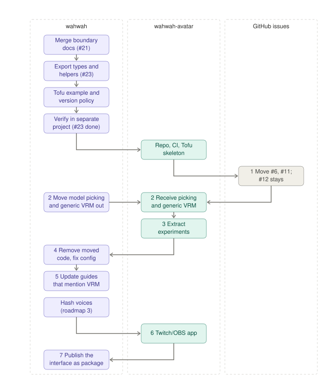

# Avatar split plan

How the avatar work moves out of `wahwah` into `wahwah-avatar`. The resulting ownership is described in [Project goals](goals.md) and the [architecture guide](architecture.md). This document covers the method, the order, and what moves.

## Starting conditions

Do not create the repository or move code or issues until all three hold.

1. **Consumable interface** (roadmap item 1, [#23](https://github.com/pomodorozhong/wahwah/issues/23)). Met. `RenderedUtterance` and `FaceControlTrack` are exported by `wahwah/performance` in the `wahwah` package, published as the `wahwah-0.1.0.tgz` asset of the `v0.1.0` GitHub release (see the [packaging plan](packaging.md)). The [interface guide](interface.md) uses the playground as the worked example that plays a rendered performance on Tofu. Publishing to npm follows after the split is finished (step 7).
2. **Boundary documented.** The goals and architecture docs describe the split.
3. **Destination ready.** The repository exists with a license, CI, and a skeleton that renders Tofu from a `FaceControlTrack` using the interface in condition 1. Met. [`wahwah-avatar`](https://github.com/pomodorozhong/wahwah-avatar) has an MIT license, a Pages workflow and a playground that drives several models from one `wahwah` performance.

## Steps

Each step is its own PR. The diagram shows who does what and in what order.

1. Done: [#6](https://github.com/pomodorozhong/wahwah/issues/6) (line boil) is now [wahwah-avatar#3](https://github.com/pomodorozhong/wahwah-avatar/issues/3) and [#11](https://github.com/pomodorozhong/wahwah/issues/11) (visual styles) is [wahwah-avatar#4](https://github.com/pomodorozhong/wahwah-avatar/issues/4). [#12](https://github.com/pomodorozhong/wahwah/issues/12) (Tofu M/B/P closure, P2) stays in `wahwah` because Tofu does. A transfer gives each issue a new number; the old URL redirects, and the links in `HANDOFF.md` and `docs/` now use the new numbers.
2. Done: [`wahwah-avatar`](https://github.com/pomodorozhong/wahwah-avatar) lists local `.vrm` models at startup and loads any VRM file, so the picker, local model loading and generic VRM support now live there.
3. Extract the visual and mouth experiments, replacement mouths before optional mouth modes.
4. Done: remove what moved from `wahwah`, including the VRM model picker, its view option and the generic VRM loading path, and update `apps/playground/vite.config.ts`, `apps/playground/scripts/check-pages.mjs` and the picker tests. The voice playground and its Pages workflow stay.
5. Done: update the text that described the removed VRM view; the playground keeps the Tofu host and the Debug view: the VRM sentence in `README.md`, the VRM model and local `.vrm` instructions and the tofu-and-VRM camera sentence in `docs/playground.md`, and the VRM mentions in `docs/development-notes.md`.
6. Build the Twitch/OBS app. It needs the hash voice interface from the roadmap.
7. After the split is confirmed finished, publish the performance interface as a versioned package and move `wahwah-avatar` from the git pin to it ([#25](https://github.com/pomodorozhong/wahwah/issues/25)).

## How code moves

Copy files into `wahwah-avatar`; do not carry git history. The history stays in `wahwah`, and step 4 deletes the originals there. Note the source commit in the first commit message of each copied file set so `git blame` can be followed back.

## What stays in wahwah

Tofu is built here. `wahwah-avatar` carries a copy of its generator, motion and control mapping so its playground can render it, because the `wahwah` package does not export them.

Tofu: `apps/playground/scripts/tofu/`, `apps/playground/public/tofu/corner-cut.vrm`, `apps/playground/src/host/mappings.ts`, and their tests and pose images (`docs/face.jpg`, `docs/poses.jpg`, `apps/playground/tests/mappings.test.ts`, `apps/playground/tests/tofu.test.js`). Three.js and `@pixiv/three-vrm` stay with them.

The host code the Tofu view runs on also stays whole: `apps/playground/src/host/host.ts`, `renderer.ts`, `vrm.ts`, `follower.ts`, `faceNavigation.ts` and `studyMotion.ts`. `apps/playground/src/host/debug.ts` stays for the Debug view, which draws on its own 2D canvas. Tofu's body motion (`studyMotion.ts`), camera navigation, control smoothing and the Tofu branch of `VrmFace.load` all use them. Only the generic, non-Tofu parts of `vrm.ts` and `puppetView.ts` are trimmed in step 4, as listed below.

## What moved

Steps 2, 4 and 5 are done; the experiments (step 3) and the visual direction notes are still to move.

- Generic VRM support in `apps/playground/src/host/vrm.ts`: the non-Tofu branch of `VrmFace.load` (head-based framing, the default background, the `isTofu = false` path) and its tests. `host.ts` and `renderer.ts` have nothing that only serves other models.
- Model picking and local model loading: the VRM view option, model list, local `.vrm` loading and `vrmHost()` in `apps/playground/src/ui/puppetView.ts`, the local-model manifest in `apps/playground/vite.config.ts`, `apps/playground/src/localModels.d.ts` and `apps/playground/tests/puppetView.test.ts`.
- Experiments, from the preserved `codex/backup-puppet-experiments-2026-11-02` branch: `src/host/surfaceStyle.ts`, `src/host/inkDither.ts`, `src/host/comicPrint.ts`, `src/host/puppetMouth.ts`, `src/host/referenceMouth.ts`, `src/host/mouthModes.ts` and `scripts/remake-vrm-models.mjs`. Rework changes to `renderer.ts`, `vrm.ts`, `host.ts` and `puppetView.ts` against the current code. The snapshot also holds obsolete app code and private model archives, so do not merge it wholesale, and keep generated archives and sample model ZIPs local.
- Visual direction notes, which were removed from `docs/goals.md`. Copy them into `wahwah-avatar`'s goals when it is created. The target is a stylized, front-facing character with readable mouth poses, small head turns and secondary motion, drawn in one of three ways:
  - *Breath of the Wild*: painterly surfaces and toon shading.
  - *Return of the Obra Dinn*: one-bit monochrome and dithering. [Dithering notes](https://dukope.com/devlogs/obra-dinn/tig-32/)
  - *Into the Spider-Verse*: line work, halftones, and poses held over multiple frames. A held pose is worth trying on live speech because it may read more clearly than a mouth that changes shape on every frame. [Imageworks production notes](https://www.imageworks.com/node/1371)

  A 2.5D puppet made from warped layers and a full 3D mesh could share the same look. Deform the rig first, then apply the visual style to its colors and masks. Whether the app ships one house style or several switchable styles remains open.
